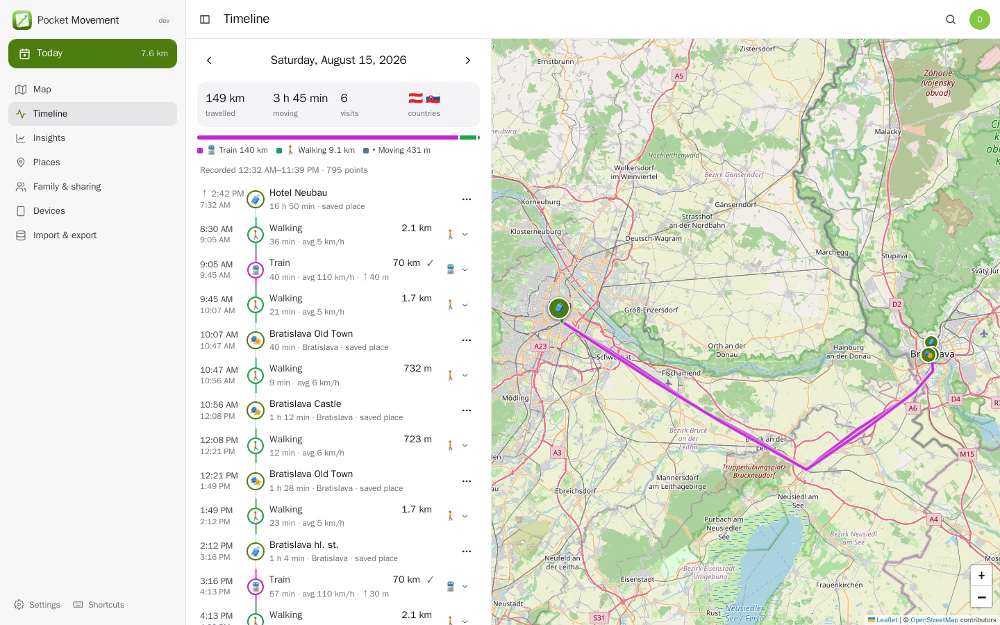
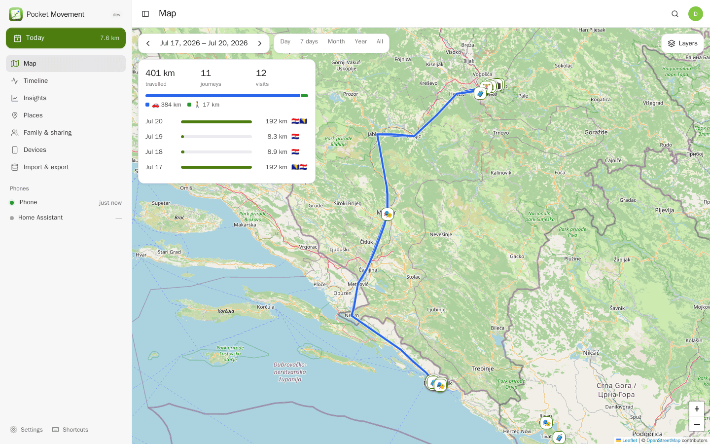
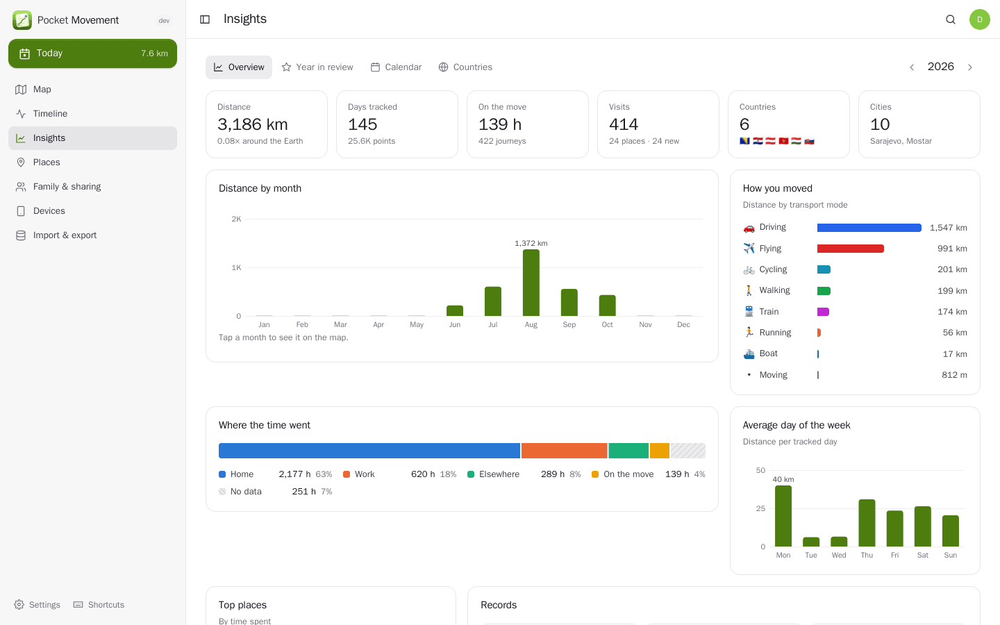
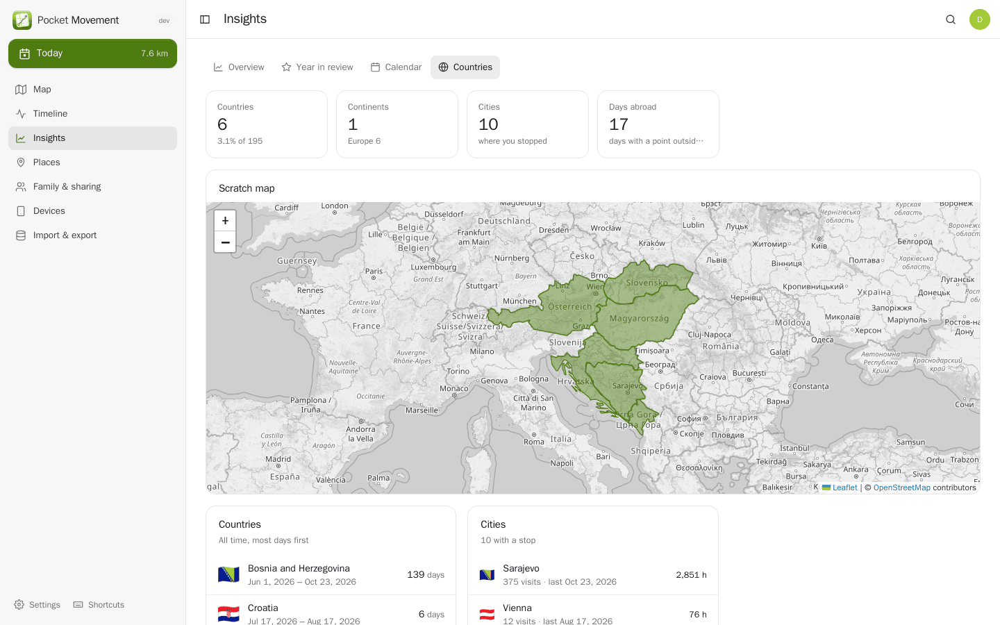
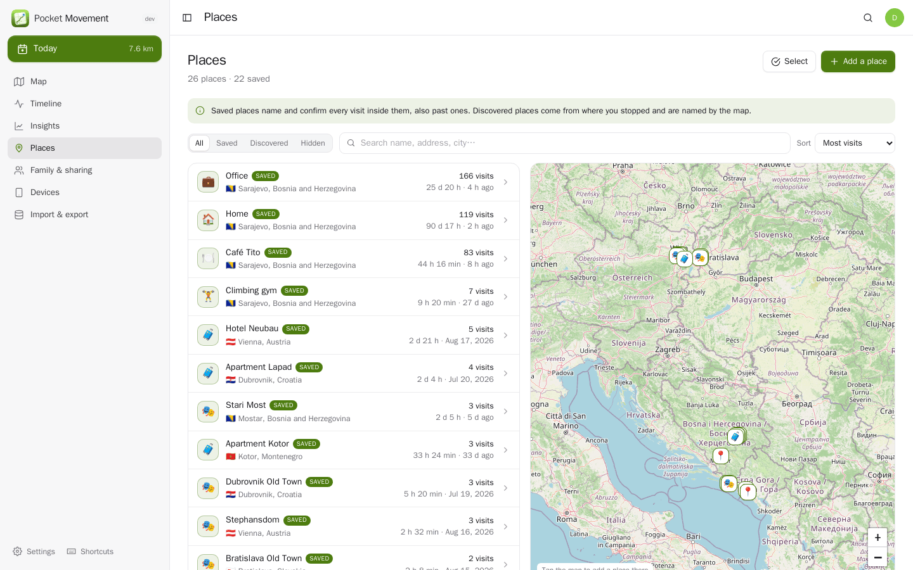
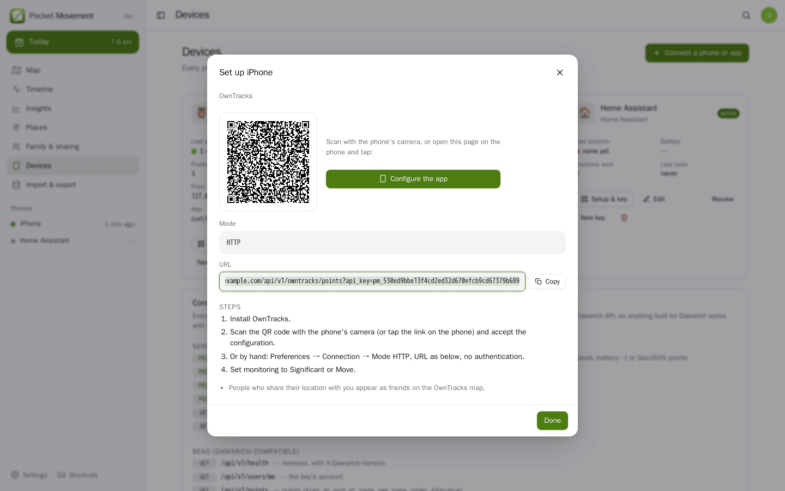
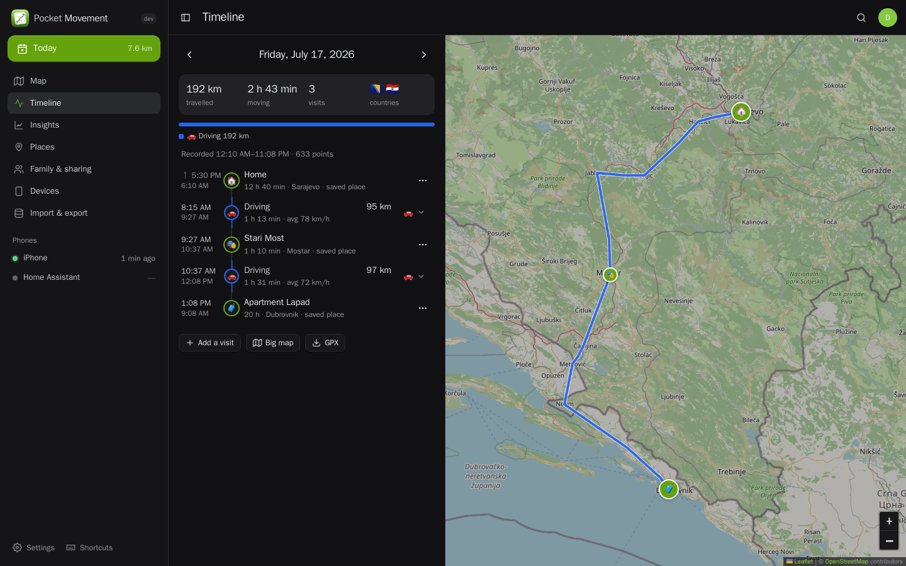
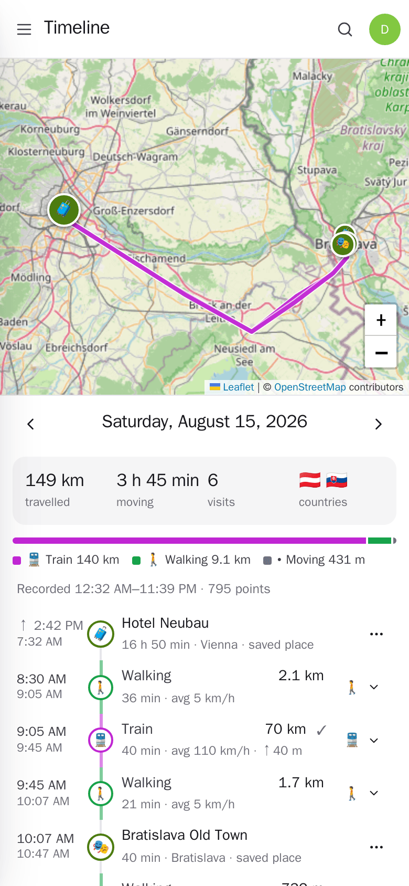
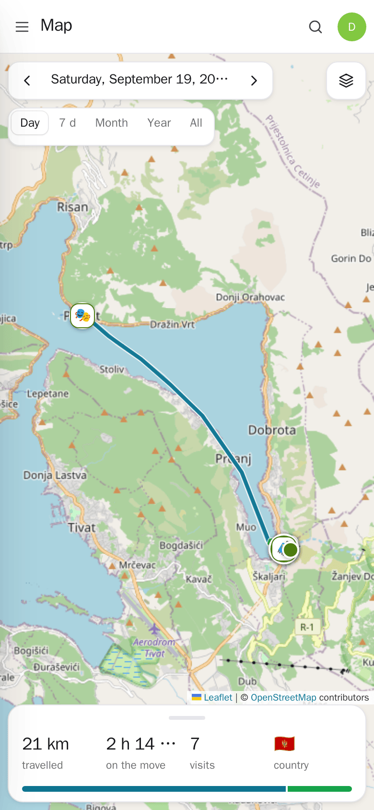

<p align="center"></p>
<h1 align="center">Pocket Movement</h1>
<p align="center">Your location history, kept at home: where you went, how and how far, the places you stop and the countries you have been — from your phone's own tracker app or the Dawarich app, whose API it speaks.<br>One Go binary, one SQLite file, one volume.</p>
<p align="center">
  <a href="https://github.com/abjelosevic88/pcket-homelab-movent/actions"></a>
  <a href="https://github.com/abjelosevic88/pcket-homelab-movent/pkgs/container/pcket-homelab-movent"></a>
  <a href="LICENSE"></a>
</p>

---

<p align="center"></p>

<table>
  <tr>
    <td width="50%"></td>
    <td width="50%"></td>
  </tr>
  <tr>
    <td align="center"><sub>Any day or range on the map, with distance per day and the countries crossed.</sub></td>
    <td align="center"><sub>Distance by month and mode, where the time went and the busiest weekdays.</sub></td>
  </tr>
  <tr>
    <td width="50%"></td>
    <td width="50%"></td>
  </tr>
  <tr>
    <td align="center"><sub>A scratch map of the countries you have been to, worked out offline.</sub></td>
    <td align="center"><sub>Saved places name and confirm every visit inside them, past ones too.</sub></td>
  </tr>
  <tr>
    <td width="50%"></td>
    <td width="50%"></td>
  </tr>
  <tr>
    <td align="center"><sub>Each phone gets its own key; OwnTracks and Overland set themselves up from a QR code.</sub></td>
    <td align="center"><sub>Dark mode.</sub></td>
  </tr>
</table>

<p align="center">
  &nbsp;&nbsp;
  
</p>

## What it does

**Records from the apps you already have**
- The **Dawarich app** (iOS, Android), **OwnTracks**, **Overland**, **GPSLogger**, **Traccar Client** and anything speaking the OsmAnd protocol, **Home Assistant**, or **your own app** with a one-line JSON API ([docs/api.md](docs/api.md)).
- Every phone or integration gets its **own key** with a scope (send, read, or both), so one can be revoked without re-pairing the others. OwnTracks and Overland **configure themselves from a QR code**.
- Uploads are idempotent: re-sending a batch never duplicates a point.

**Turns points into a timeline**
- **Visits** (where you stayed) and **journeys** (how you moved between them), with a **transport mode** guessed from speed, the phone's own activity and whether you were over water: walking, running, cycling, driving, bus, train, boat, flying. Correct a mode once and it sticks.
- Works with sparse data: phones in "significant change" mode report almost nothing while still, and an overnight silence at home is still a night at home.
- GPS **spikes** are left out of routes and totals (kept, not deleted); a flight with the phone off is not mistaken for one.
- **Places**: save home, work or the gym with a radius and every visit inside is named and confirmed — back in time too. Other places are named by OpenStreetMap; rename one and all its visits follow. Merge duplicates.
- **Workouts** from Pocket Health (your watch and phone send them there): every run, walk, ride or hike in a list by day, drawn on the map from the positions recorded here while it ran, with the recorded distance — through a Pocket Core link or a direct connection.
- **Countries offline**: borders are built in (Natural Earth), so countries need no geocoder and no network.

**Shows and reports it**
- A **map** of any day or range: journeys coloured by speed or mode, every point, a **heat map**, the **fog of war**, saved places, family, and where you are now — live.
- A **timeline** per day to confirm, decline, rename or add visits.
- **Insights**: distance by month and mode, where the time went (home, work, elsewhere, moving), weekdays, top places, records, a calendar heat map, a **year in review**, and a **scratch map** of the countries you have been to.

**Shares on your terms**
- Share your live position (or also your history) with people on the box, rounded to ~1 or ~10 km if you like, for an hour or for good — they appear on your map and as friends in OwnTracks.
- **Links** that show your live position without an account, expiring when you say.
- **Privacy zones**: never shown to others or exported, or dropped on arrival.

**Moves in and out freely**
- Import **Google Takeout** (Records.json, Semantic Location History — place visits keep their names), the phone's **Timeline export** (Android and iOS), **GPX**, **KML**, **GeoJSON** (Dawarich exports too), **OwnTracks .rec**, **CSV**, or a **ZIP** of any of them. Everything streams: a multi-gigabyte Takeout is fine.
- **Move over from Dawarich** in one step: give its address and API key and areas, confirmed visits and every point come across through its API. Leave it **linked** and new points keep coming over every few minutes, so a phone can go on reporting to Dawarich while you switch.
- Export GeoJSON, GPX or CSV.

**A Dawarich drop-in**
- The Dawarich API (v1.16): health, users/me, points, visits, areas, stats, timeline, tracks, settings. Pocket Travel, Pocket Garage, Pocket Core's Dawarich connector and Home Assistant's Dawarich integration work against it unchanged.

## Compared with Dawarich

| | Dawarich | Pocket Movement |
|---|---|---|
| To run | Rails, PostgreSQL + PostGIS, Redis, Sidekiq (4 containers) | one binary and one SQLite file |
| Keys | one per account | one per device, with a scope; revoke one without the others |
| Countries | reverse-geocode every point (Photon/Nominatim) | built-in borders, offline, instant |
| Visits with sparse points | need regular points | a silence while still counts as staying |
| Transport modes | yes | yes, plus over-water and bus detection, corrections survive rebuilds |
| Saved places | areas | saved places name and confirm visits, past ones too |
| Big Google imports | background jobs | streamed straight from disk |
| Sharing | family (cloud plans) | people on the box and expiring links, with rounding and privacy zones; OwnTracks friends |
| Setup on the phone | type the URL and key | QR codes for OwnTracks and Overland |

## Run it

```sh
docker run -d --name pocket-movement -p 8080:8080 -v ./data:/data \
  -e BASE_URL=https://movement.example.com -e TZ=Europe/Sarajevo \
  ghcr.io/abjelosevic88/pocket-homelab-movement:latest
```

Open it, create the first account (you become the admin), then **Devices → Connect a phone or app**. `DEMO_DATA=true` fills an empty box with two weeks of made-up movement. All settings: [docs/configuration.md](docs/configuration.md). Behind a proxy: [docs/reverse-proxy.md](docs/reverse-proxy.md). Backups: [docs/backup.md](docs/backup.md).

With [Pocket Core](https://github.com/abjelosevic88/pocket-homelab-core), add `CORE_URL` and `CORE_REGISTRATION_KEY`: people sign in with Pocket Core, other Pocket apps can read your timeline through app links, Pocket AI can answer "where was I last Tuesday?", and events (new country, tracking stopped) reach your phone.

## Build

```sh
make all        # web UI + binary
make dev        # API on :8080 + Vite on :5173 with demo data
make test       # Go tests + type check
```

## License

MIT. Country borders: [Natural Earth](https://www.naturalearthdata.com/) (public domain).
